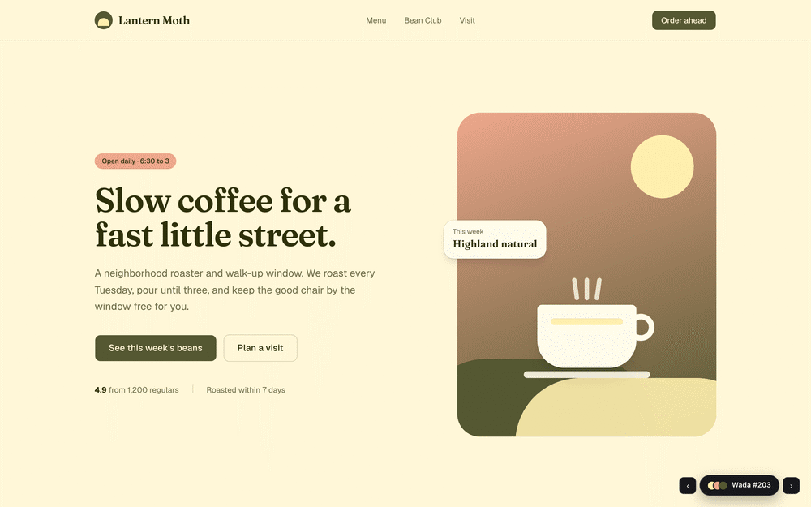
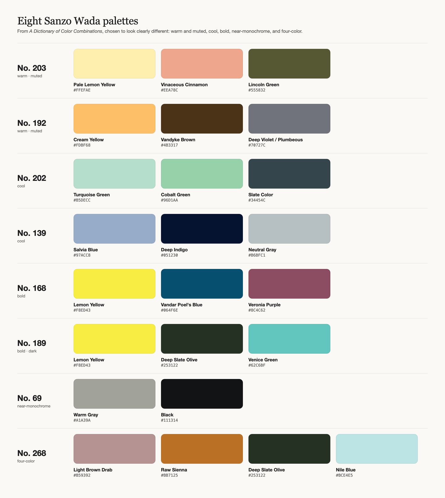
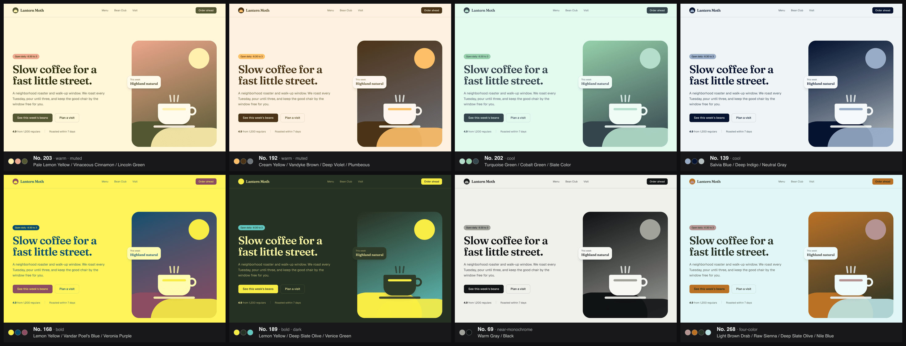

[Agent Skills](https://docs.claude.com/en/docs/agents-and-tools/agent-skills/overview) for Claude.



| Skill | What it does |
| --- | --- |
| [sanzo-wada-palettes](skills/sanzo-wada-palettes/SKILL.md) | Color palettes from Sanzo Wada's *A Dictionary of Color Combinations*, applied to your site with a live theme switcher |

---

## sanzo-wada-palettes

Sanzo Wada's *A Dictionary of Color Combinations* (1933–34) is a classic Japanese reference of 348 hand-picked color pairings, trios, and quartets drawn from 159 colors. This skill gives Claude the whole dictionary and a workflow for turning those combinations into real themes.

### What you can ask for

- "Give my site a Sanzo Wada palette, something warm and muted."
- "Use Wada combination 176."
- "Find three Wada palettes that include a deep teal."
- "Pick a Wada palette for a fall outfit."

### What Claude does



1. **Loads the data** from the MIT-licensed [`dictionary-of-colour-combinations`](https://github.com/mattdesl/dictionary-of-colour-combinations) dataset by Matt DesLauriers and rebuilds every numbered combination.
2. **Chooses palettes** by combination number, color count (2–4), mood (warm/cool, muted/bold) or a color you want included (nearest match in LAB space).
3. **Maps each palette to a full theme**, the complete set of Tailwind/shadcn CSS variables (`--background`, `--primary`, `--accent`, `--muted`, `--border`, `--ring` and the rest). It checks WCAG contrast (4.5:1 for body text) and derives tints when a pair fails.
4. **Adds a theme switcher** to web projects:
   - a small floating button that lists every candidate palette with its swatches
   - one-click apply, prev/next arrows, and `[` / `]` keyboard shortcuts
   - a "Copy CSS" button that copies the current theme as a ready-to-paste `:root { … }` block
   - your choice is remembered across pages and reloads
   - it shows only in development, or with `?themes=1` on the URL, so you can send a Vercel preview link to a client and let them flip through palettes while normal visitors never see it

   

5. **Locks in the winner.** Say "lock in 176" and Claude writes that theme into `globals.css` as the default.

It also handles plain-CSS sites (vanilla JS switcher), print and design work (hex, RGB, and CMYK per color), and outfits (which color for base, main, and accent).

To run the demo site: `cd demo && npm i && npm run dev`, then open http://localhost:3000/?themes=1.

---

## Install

### Claude Code

```
/plugin marketplace add khanmo97/claude-skills
/plugin install sanzo-wada-palettes@khanmo97-skills
```

Or copy `skills/sanzo-wada-palettes/` into `~/.claude/skills/` (all projects) or `.claude/skills/` (one project).

### Claude apps (claude.ai, desktop)

Download the `skills/sanzo-wada-palettes` folder, zip it, and upload it as a custom skill in Claude's settings.

### Claude API / Agent SDK

Upload the skill folder through the Skills API. See the [Agent Skills docs](https://docs.claude.com/en/docs/agents-and-tools/agent-skills/overview).

---

## Credits

- Color data: [mattdesl/dictionary-of-colour-combinations](https://github.com/mattdesl/dictionary-of-colour-combinations) (MIT)
- Original work: Sanzo Wada, *A Dictionary of Color Combinations*. The print edition is published by Seigensha, and it's worth owning.

## License

Apache 2.0. See [LICENSE](LICENSE).
